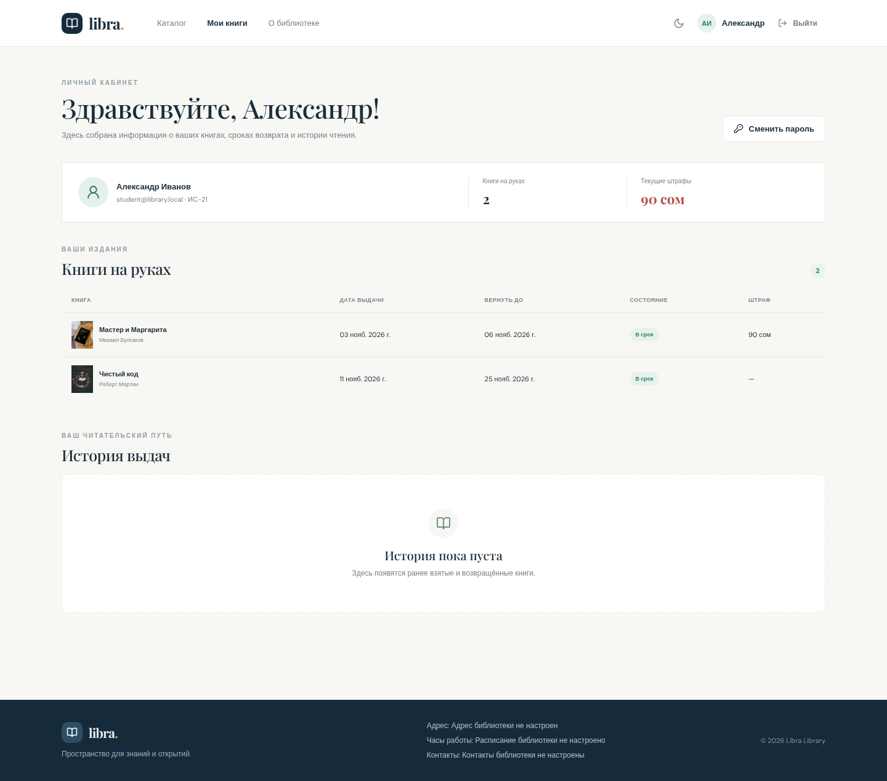
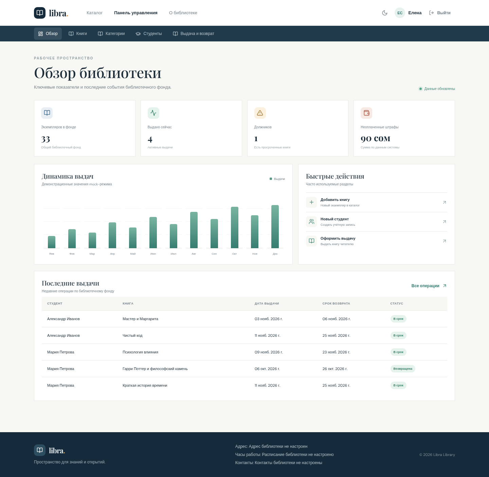
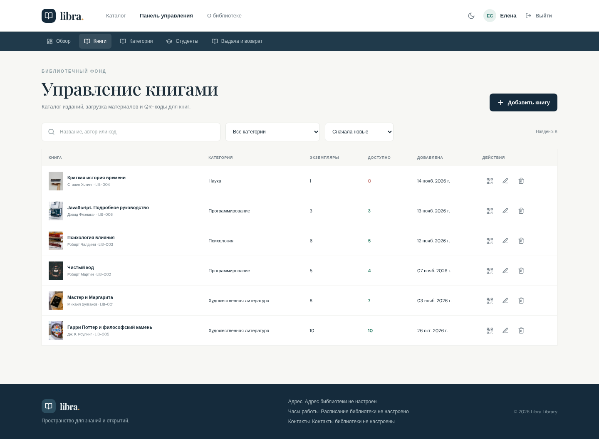
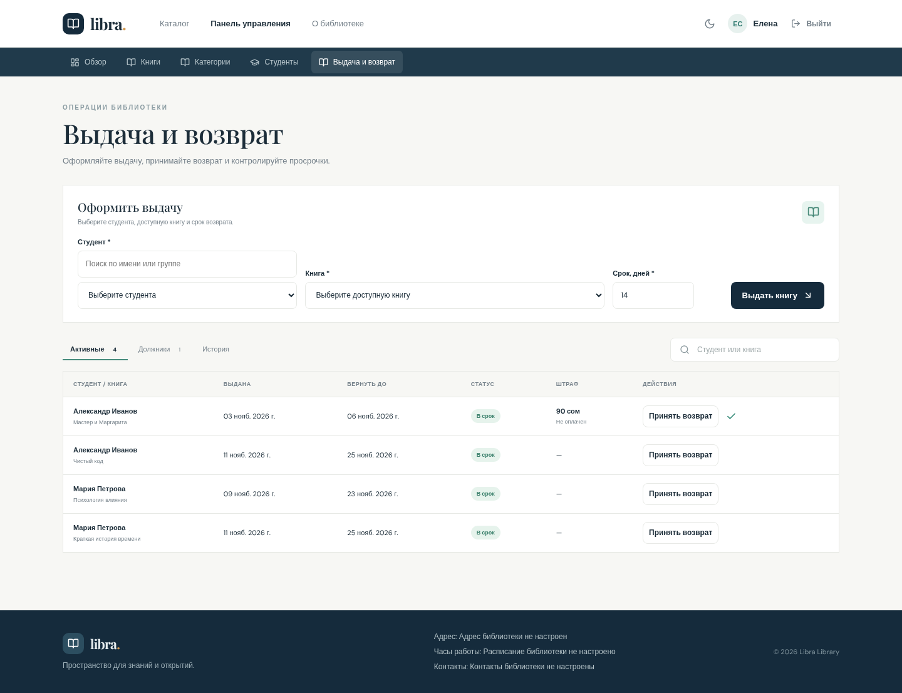

# Libra — Frontend онлайн-библиотеки

Адаптивный frontend для Library Management System. Реализованы публичный каталог, вход по JWT, кабинет студента, онлайн-просмотр PDF и административная панель. Проект написан на React + TypeScript + Vite.

> **Важно о backend:** документация API и фактические схемы эндпоинтов не были приложены к техническому заданию. Поэтому проект запускается полностью в mock-режиме и содержит отдельный REST-слой с согласованными типовыми маршрутами. Перед подключением к вашему backend проверьте таблицу маршрутов в разделе «Подключение реального API» и названия полей/ответов по его Swagger/OpenAPI.

## Стек

- React 18, TypeScript, Vite 6
- React Router 6 — маршрутизация и защита по ролям
- Axios — общий HTTP-клиент, JWT interceptor, централизованная обработка 401
- CSS — Mobile First: базовые стили описывают мобильную раскладку, планшет и ПК подключаются через `@media (min-width: ...)`. Единая дизайн-система на CSS-переменных, тёмная тема.
- `qrcode` — генерация QR-кодов книг
- Vitest + React Testing Library — unit-тесты утилит форматирования и статусов сроков
- ESLint + Prettier — единый стиль кода

## Запуск

Требуется Node.js 20 или новее.

```bash
npm install
cp .env.example .env
npm run dev
```

В репозитории есть `package-lock.json`, поэтому для воспроизводимой установки можно использовать `npm ci`. Vite запустит приложение на `http://localhost:5173`.

Проверка production-сборки:

```bash
npm run build
npm run preview
```

Проверка качества и тесты:

```bash
npm run lint
npm run format:check
npm run test
```

## Переменные окружения

Скопируйте `.env.example` в `.env`:

```dotenv
VITE_API_URL=http://localhost:8080/api
VITE_USE_MOCKS=true
VITE_LIBRARY_ADDRESS=г. Бишкек, просп. Чуй 207
VITE_LIBRARY_HOURS=Пн–Пт 9:00–19:00, Сб 10:00–16:00, Вс — выходной
VITE_LIBRARY_CONTACT=+996 (312) 90-00-90 · info@library.local
```

- `VITE_API_URL` — базовый адрес backend API без завершающего `/`.
- `VITE_USE_MOCKS=true` — демонстрационные данные, имитация сетевых запросов и локальное сохранение изменений в `localStorage`.
- `VITE_USE_MOCKS=false` — запросы к реальному backend через Axios.
- `VITE_LIBRARY_ADDRESS`, `VITE_LIBRARY_HOURS`, `VITE_LIBRARY_CONTACT` — публичные адрес, расписание и контакт библиотеки для главной страницы и footer. В `.env.example` записаны демо-значения, чтобы главная страница выглядела законченной сразу после запуска; замените их реальными данными перед публикацией. Пустые значения явно отображаются как ненастроенные.

Сам `.env` исключён из Git через `.gitignore`; в репозиторий добавляется только `.env.example`.

## Демо-аккаунты

В mock-режиме доступны следующие учётные записи:

| Роль                                          | Email                    | Пароль       |
| --------------------------------------------- | ------------------------ | ------------ |
| STUDENT                                       | `student@library.local`  | `student123` |
| STUDENT                                       | `student2@library.local` | `student123` |
| ADMIN                                         | `admin@library.local`    | `admin123`   |
| Заблокированный STUDENT (проверка блокировки) | `blocked@library.local`  | `student123` |

Новый студент, созданный из административной панели в mock-режиме, может войти с указанным email и временным паролем, который администратор задал при создании. Mock API сохраняет этот пароль в демонстрационной базе браузера.

Все mock-данные хранятся в `localStorage` браузера под ключом `library_mock_db_v2`. Для сброса демонстрационной базы удалите этот ключ в DevTools → Application → Local Storage и перезагрузите приложение. Токен хранится под ключом `library_access_token`, пользователь — `library_user`.

## Роли и страницы

### Гость

- `/` — главная, популярные и новые книги, сведения о библиотеке.
- `/books` — каталог, поиск по названию/автору (debounce 400 мс), фильтр, сортировка, пагинация.
- `/books/qr/:code` — публичная карточка книги по QR-коду.
- `/login` — вход; самостоятельной регистрации нет.

### STUDENT

- `/books/:id` — карточка книги и доступность экземпляров.
- `/books/:id/read` — встроенный PDF viewer с переходом к странице по номеру и управлением масштабом.
- `/profile` — книги на руках, сроки возврата, штрафы и история, смена пароля.

### ADMIN

- `/admin` — статистика, активность и быстрые действия.
- `/admin/books` — CRUD книг, загрузка обложки/PDF, QR-код и скачивание PNG.
- `/admin/categories` — CRUD категорий.
- `/admin/students` — создание студентов, блокировка/разблокировка и карточка истории выдач.
- `/admin/loans` — выдача, активные выдачи, возврат, список должников и отметка оплаты штрафа.

Общие страницы: `/403` и `404`. Выход доступен из шапки во всех авторизованных зонах.

## Подключение реального API

Базовый Axios-клиент находится в `src/api/http.ts`. Он:

- добавляет `Authorization: Bearer <JWT>` из `localStorage`;
- централизованно обрабатывает ошибки;
- при HTTP 401 удаляет токен и пользователя, завершает сессию и отправляет пользователя на `/login` с уведомлением «Сессия истекла».

Все операции находятся в `src/api/services.ts`. Сейчас REST-режим ожидает следующие типовые маршруты:

| Операция                      | Метод и путь                                                                           |
| ----------------------------- | -------------------------------------------------------------------------------------- |
| Вход                          | `POST /auth/login`                                                                     |
| Смена пароля                  | `POST /auth/change-password`                                                           |
| Каталог книг                  | `GET /books` с `search`, `categoryId`, `sort`, `page`, `limit`                         |
| Карточка книги                | `GET /books/:id`                                                                       |
| Поиск книги по QR-коду        | `GET /books/qr/:code`                                                                  |
| Создание книги                | `POST /books`                                                                          |
| Изменение книги               | `PUT /books/:id`                                                                       |
| Удаление книги                | `DELETE /books/:id`                                                                    |
| Категории                     | `GET /categories`, `POST /categories`, `PUT /categories/:id`, `DELETE /categories/:id` |
| Статистика                    | `GET /admin/dashboard`                                                                 |
| Студенты                      | `GET /admin/students`, `POST /admin/students`                                          |
| Блокировка студента           | `PATCH /admin/students/:id/block`                                                      |
| Список выдач                  | `GET /admin/loans`                                                                     |
| Сводка должников по студентам | `GET /admin/debtors`                                                                   |
| Создание выдачи               | `POST /admin/loans`                                                                    |
| Возврат                       | `POST /admin/loans/:id/return`                                                         |
| Оплата штрафа                 | `PATCH /admin/loans/:id/pay-fine`                                                      |
| Книги и история студента      | `GET /loans/my`                                                                        |

Ожидаемый формат пагинированного каталога:

```json
{
  "items": [],
  "total": 0,
  "page": 1,
  "totalPages": 1
}
```

Схемы сущностей и названия полей в `src/types.ts`. Для корректной подсветки срока backend должен возвращать `status` (`ACTIVE`, `OVERDUE`, `RETURNED`) и `daysRemaining` (число дней до срока; поле может быть отрицательным при просрочке). Frontend только отображает эти значения. Если backend возвращает иной формат, преобразование следует выполнить в `src/api/services.ts`, не перенося сетевую логику в компоненты. Для загрузки файлов используется `multipart/form-data`, поля `coverFile` и `pdfFile`; уточните эти имена по документации backend.

Предпочтительный формат `GET /loans/my`:

```json
{
  "items": [],
  "unpaidFineTotal": 0
}
```

`unpaidFineTotal` должен рассчитываться backend. Совместимость с устаревшим ответом-массивом оставлена для списка выдач, но в таком случае сумма штрафов в профиле намеренно отображается как `—`, а не вычисляется в браузере. Административный список должников получает агрегированные данные отдельным `GET /admin/debtors` и только отображает их. Предпочтительная схема элемента: `{ studentId, loans, unpaidFineTotal }`; сумма и состав задолженности формируются на backend. Пример элемента ответа:

```json
{
  "studentId": "student-id",
  "loans": [],
  "unpaidFineTotal": 0
}
```

**Бизнес-правила не дублируются во frontend:** штраф, доступность экземпляров и статус выдачи в реальном режиме должны приходить от сервера. В mock-режиме упрощённая логика нужна только для демонстрации UI. Адрес, часы работы и контакты задаются через `VITE_LIBRARY_ADDRESS`, `VITE_LIBRARY_HOURS` и `VITE_LIBRARY_CONTACT`; заполните их перед публикацией.

## Структура

```text
src/
  api/                  # Axios client, REST services, mock API
  components/           # переиспользуемые карточки, таблицы, модальные окна
  context/              # AuthContext, ToastContext
  hooks/                # debounce
  config.ts             # публичная информация библиотеки из env
  layouts/              # общий layout и навигация
  pages/                # публичные, студенческие и административные страницы
  utils/                # форматирование дат/денег и тесты
  main.tsx              # маршруты и провайдеры
  routes.tsx            # защита по ролям
  styles.css            # дизайн-система и адаптивные стили
  types.ts              # типы доменных сущностей
```

## Выполненные бонусы

- TypeScript.
- Тёмная тема с переключателем в шапке.
- Демо-график выдач на дашборде только в mock-режиме; в real API режиме вместо фиктивных значений показывается требование к endpoint статистики.
- Базовые unit-тесты форматирования и статусов сроков.

Не реализованы необязательные бонусы: сканирование QR камерой, сохранение прогресса чтения на backend, бронирование, CSV/Excel-экспорт и мультиязычность.

## Скриншоты

Основные экраны приложения в mock-режиме (desktop 1440px и mobile 375px):

| Главная (desktop)                                               | Каталог (mobile)                                        |
| --------------------------------------------------------------- | ------------------------------------------------------- |
|  |  |

| Личный кабинет студента                                 | Дашборд администратора                                                  |
| ------------------------------------------------------- | ----------------------------------------------------------------------- |
|  |  |

| Управление книгами                                              | Выдача и возврат                                              |
| --------------------------------------------------------------- | ------------------------------------------------------------- |
|  |  |

Дополнительно: [вход (mobile)](docs/screenshots/login-mobile.png), [карточка книги (desktop)](docs/screenshots/book-detail-desktop.png).

## Перед сдачей проекта

- Сверьте маршруты и DTO в `src/api/services.ts` с фактической OpenAPI/Swagger-документацией backend.
- Заполните `VITE_LIBRARY_ADDRESS`, `VITE_LIBRARY_HOURS` и `VITE_LIBRARY_CONTACT` в `.env` для целевой библиотеки.
- Опубликуйте проект (Vercel/Netlify) и добавьте ссылку на репозиторий и деплой.

## Отчёт проверки

Подробный отчёт о соответствии ТЗ, внесённых исправлениях, фактически выполненных проверках и оставшихся ограничениях находится в [AUDIT_REPORT.md](./AUDIT_REPORT.md).
